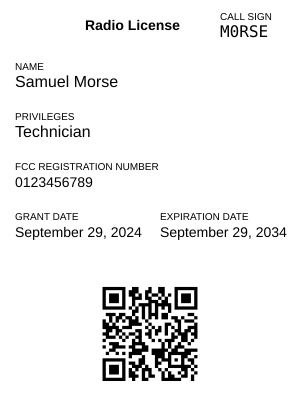
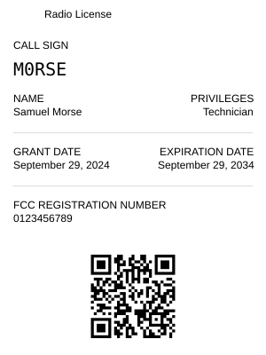

# HAMRadioWallet.com

> A web application enabling Amateur Radio and GMRS licensees to add their license to Apple Wallet and Google Wallet.

Built and maintained by [@NicPWNs](https://github.com/NicPWNs) / N1CPJ

## 🪪 Examples

<table align="center" border="0">
 <tr>
    <td align="center"><b>Apple Wallet</b></td>
    <td align="center"><b>Google Wallet</b></td>
 </tr>
 <tr>
    <td></td>
    <td></td>
 </tr>
</table>

> Like this project? Give it a [⭐ on GitHub!](https://github.com/NicPWNs/hamradiowallet.com)

## 🚀 Usage

1. Visit [HAMRadioWallet.com](https://hamradiowallet.com).
2. Enter your amateur radio or GMRS callsign and ZIP code.
3. Add the generated pass to your device's wallet.

The callsign's format determines which FCC service it is looked up in, so there
is nothing else to select: amateur callsigns end in letters (`K1ABC`) and GMRS
callsigns end in digits (`WRAB123`).

_Don't have a license?_ Use callsign **M0RSE** (amateur) or **MORS001** (GMRS)
with ZIP code **02720** to test!

## 💡 Support & Contributions

- Found a bug or have a question? [Open an issue](https://github.com/NicPWNs/hamradiowallet.com/issues)
- Want to contribute? [Submit a pull request](https://github.com/NicPWNs/hamradiowallet.com/pulls)

## ❤️ Support

Please tell your amateur radio operator clubs and friends!

If you find this project useful, consider [sponsoring the developer](https://github.com/sponsors/NicPWNs).

## ⚖️ Legal

HAMRadioWallet.com is not affiliated with, endorsed by, or sponsored by the Federal Communications Commission (FCC). This is an independent project created to help amateur radio and GMRS licensees digitize their license information. All trademarks and registered trademarks are the property of their respective owners.
